<p align="center">
  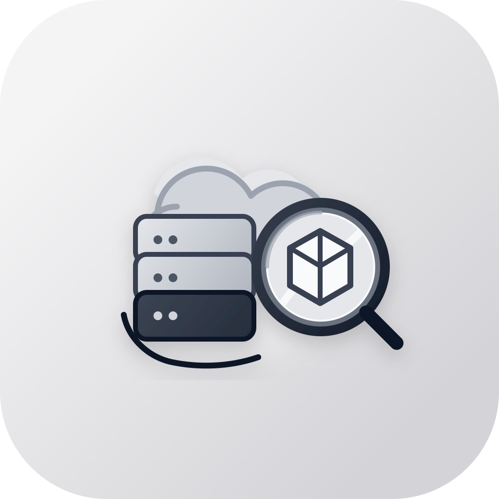
</p>

<h1 align="center">StackPort</h1>
<p align="center"><strong>A web console for local AWS emulators and real AWS accounts.</strong></p>
<p align="center">Browse, inspect, and manage resources across 35 AWS services, with dedicated views for 13 of them and guided lessons that teach AWS hands-on.</p>

<p align="center">
  <a href="https://github.com/DaviReisVieira/stackport/actions/workflows/ci.yml"></a>
  <a href="https://pypi.org/project/stackport/"></a>
  <a href="https://hub.docker.com/r/davireis/stackport"></a>
  <a href="https://hub.docker.com/r/davireis/stackport"></a>
  <a href="https://github.com/DaviReisVieira/stackport/blob/main/LICENSE"></a>
  <a href="https://pypi.org/project/stackport/"></a>
  <a href="https://github.com/DaviReisVieira/stackport/stargazers"></a>
</p>

<p align="center">
  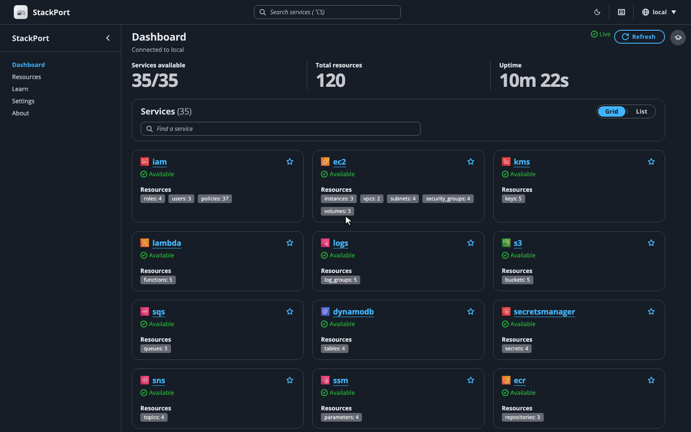
</p>

## Why StackPort

Local emulators give you AWS on your laptop, but no console to look at it with. StackPort is that console: open source, runs locally with one command, and needs no AWS account. It talks to any AWS-compatible endpoint, and it can point at a real AWS account too, with a single setting to make it read-only.

## Features

- **35 AWS services** discovered and counted on a live dashboard (WebSocket updates, pinned favorites, light and dark themes)
- **13 dedicated service views**: S3, DynamoDB, Lambda, SQS, SNS, IAM, EC2, RDS, CloudWatch Logs, CloudWatch metrics and alarms, Secrets Manager, KMS, and Step Functions. Every other service gets a searchable resource table
- **Write operations** in 9 of those views, from S3 uploads and DynamoDB item edits to SQS messages, Lambda invokes, EC2 start/stop, and Step Functions executions
- **Guided lessons** that run inside the console and check your real resource state as you go
- **Real AWS and multiple endpoints**, each with its own auth (default chain, AWS profile with SSO/AssumeRole, or static keys)
- **Read-only mode** with `STACKPORT_ALLOW_WRITES=false`
- **Tags** viewed and edited across 24 resource types
- **Export** resource lists to JSON or CSV, and a **CLI** for `status`, `list`, `describe`, and `export`
- **Keyboard shortcuts** for navigation (press `?` to see them)
- Single Docker image or `pip install`. Works with [MiniStack](https://github.com/ministackorg/ministack), [Floci](https://github.com/floci-io/floci), [LocalStack](https://github.com/localstack/localstack), [Moto](https://github.com/getmoto/moto), [AWS Emulator](https://github.com/aws/aws-emulator), or any AWS-compatible endpoint

## Screenshots

<table>
  <tr>
    <td width="50%">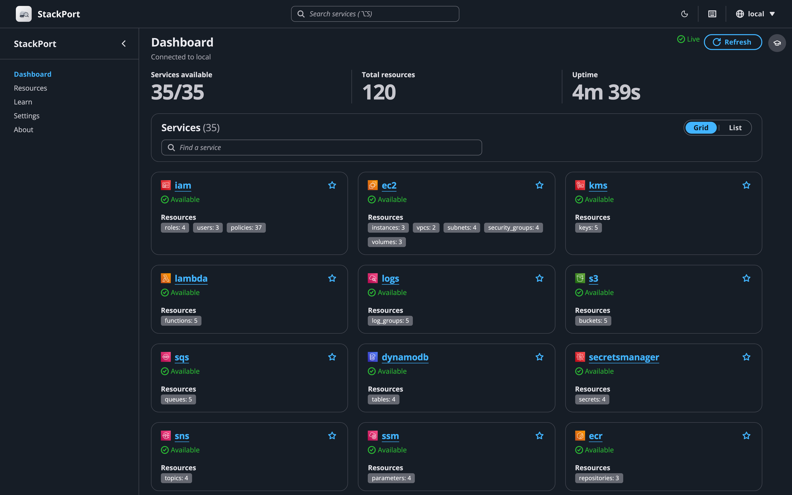<br/><sub><b>Dashboard</b>: every service with live resource counts</sub></td>
    <td width="50%">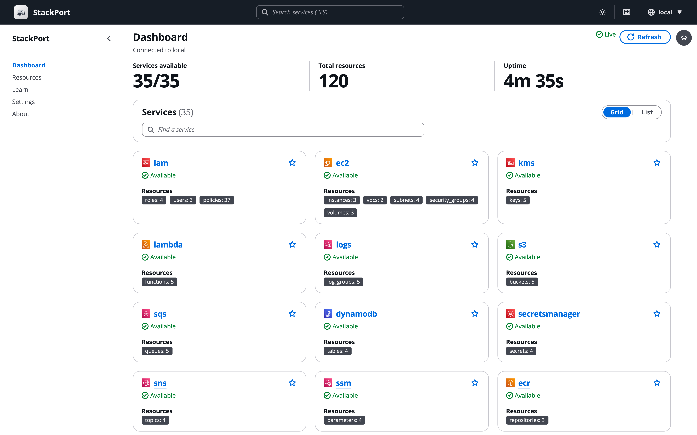<br/><sub><b>Light mode</b>: light, dark, or follow the system</sub></td>
  </tr>
  <tr>
    <td>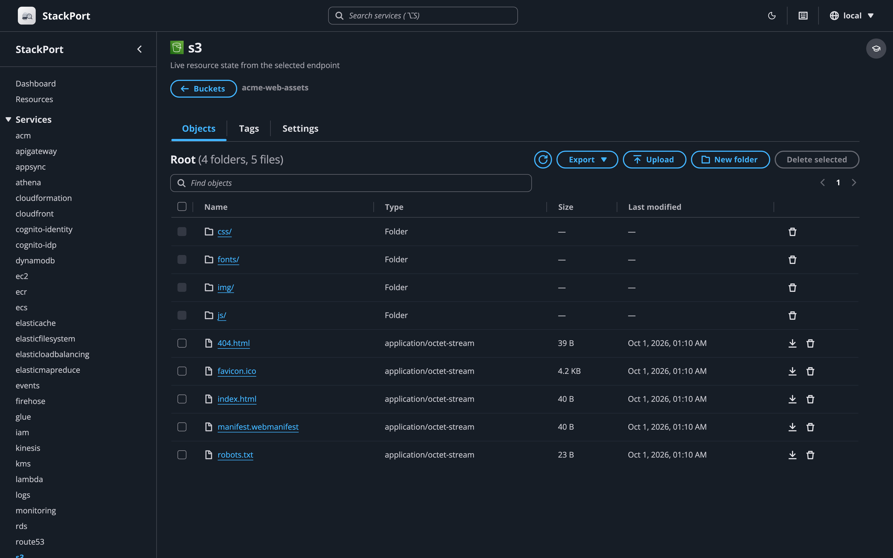<br/><sub><b>S3</b>: folders, upload, download, bucket settings</sub></td>
    <td>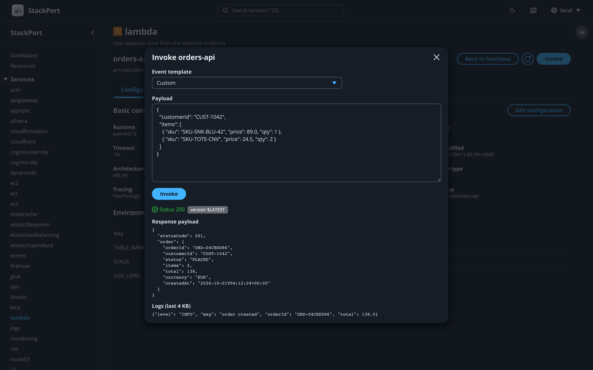<br/><sub><b>Lambda</b>: config, aliases, versions, invoke</sub></td>
  </tr>
  <tr>
    <td>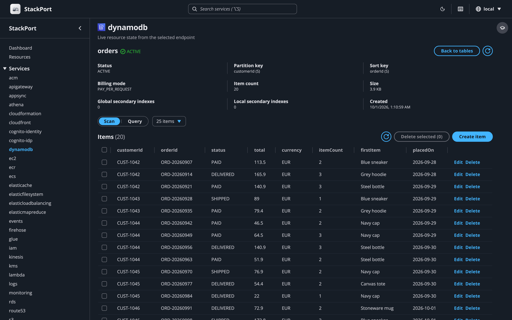<br/><sub><b>DynamoDB</b>: scan, query, and edit items</sub></td>
    <td>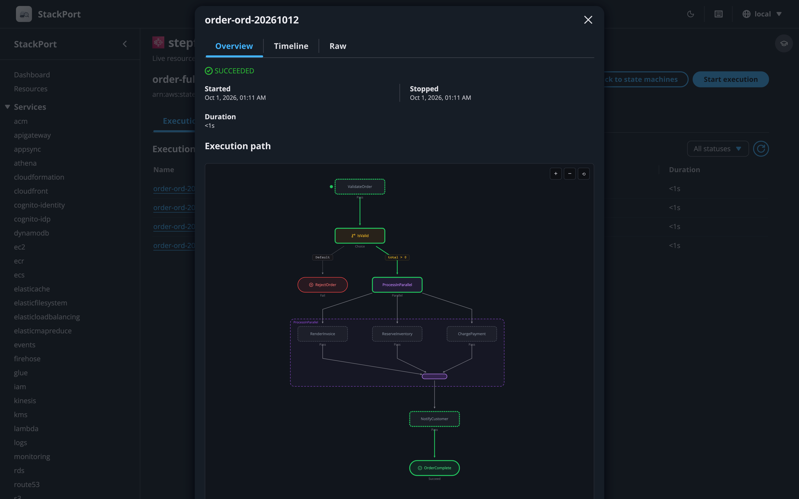<br/><sub><b>Step Functions</b>: state machine graph and execution timeline</sub></td>
  </tr>
  <tr>
    <td>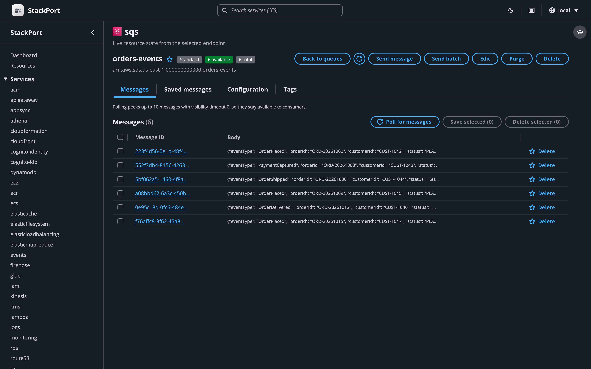<br/><sub><b>SQS</b>: send, receive, purge, dead-letter queues</sub></td>
    <td>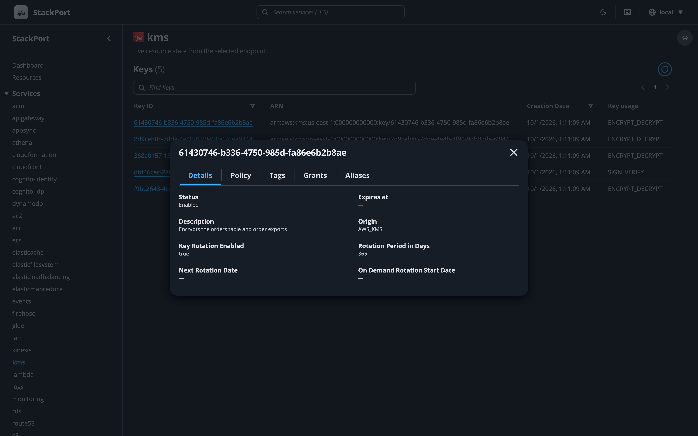<br/><sub><b>KMS</b>: keys, policies, grants, aliases</sub></td>
  </tr>
</table>

## Quick Start

### With a local emulator

Start whichever emulator you use, then point StackPort at it:

```bash
# Start an emulator on :4566 (pick one)
docker run -d -p 4566:4566 ministackorg/ministack   # MiniStack
docker run -d -p 4566:4566 floci/floci              # Floci

# Start StackPort
pip install stackport
AWS_ENDPOINT_URL=http://localhost:4566 stackport
# Open http://localhost:8080
```

### Docker Compose

Each example runs the emulator, StackPort, and a one-shot `seed` container that creates a few resources (S3, SQS, SNS, DynamoDB, Secrets Manager, IAM, Logs, Step Functions) so the dashboard has something to show on first load. They all use the same seed. Swap in LocalStack, Moto, or any AWS-compatible endpoint by replacing the emulator service and updating `AWS_ENDPOINT_URL`.

**MiniStack + StackPort**: [`examples/docker-compose.yml`](examples/docker-compose.yml)

```bash
curl -O https://raw.githubusercontent.com/DaviReisVieira/stackport/main/examples/docker-compose.yml
docker compose up -d
# Open http://localhost:8080
# If the dashboard is empty: docker compose logs seed
```

[MiniStack](https://github.com/ministackorg/ministack) derives the URLs it returns (SQS queue URLs, pre-signed URLs) from the request `Host`, so they resolve from other containers and from the host without extra configuration.

**Floci + StackPort**: [`examples/docker-compose.floci.yml`](examples/docker-compose.floci.yml)

```bash
curl -O https://raw.githubusercontent.com/DaviReisVieira/stackport/main/examples/docker-compose.floci.yml
docker compose -f docker-compose.floci.yml up -d
# Open http://localhost:8080
# If the dashboard is empty: docker compose -f docker-compose.floci.yml logs seed
```

[Floci](https://github.com/floci-io/floci) takes the hostname for the URLs it returns from `FLOCI_HOSTNAME`, which the example sets to `floci` so they resolve from other containers. From the host, reach the same resources through `http://localhost:4566`.

**AWS Emulator + StackPort**: [`examples/docker-compose.aws-emulator.yml`](examples/docker-compose.aws-emulator.yml)

```bash
curl -O https://raw.githubusercontent.com/DaviReisVieira/stackport/main/examples/docker-compose.aws-emulator.yml
docker compose -f docker-compose.aws-emulator.yml up -d
# Open http://localhost:8080
# If the dashboard is empty: docker compose -f docker-compose.aws-emulator.yml logs seed
```

[AWS Emulator](https://github.com/aws/aws-emulator) serves HTTPS with its own certificate and, by default, only accepts requests signed with keys it creates, both new on every start. StackPort reads them from `~/.aws/emulator/<port>/`, so it keeps working after a restart. There is no prebuilt image, so the first `up` builds one from the Dockerfile in [AWS's guide](https://docs.aws.amazon.com/emulator/latest/userguide/getting-started-docker.html), and the emulator keeps everything in memory.

### Docker (standalone)

```bash
docker run -p 127.0.0.1:8080:8080 -e AWS_ENDPOINT_URL=http://host.docker.internal:4566 davireis/stackport
```

### Other emulators

StackPort works with any AWS-compatible endpoint. Set `AWS_ENDPOINT_URL`:

```bash
# LocalStack
AWS_ENDPOINT_URL=http://localhost:4566 stackport

# Moto
AWS_ENDPOINT_URL=http://localhost:5000 stackport

# AWS Emulator, started as in AWS's guide (StackPort reads its keys and certificate from ~/.aws/emulator)
AWS_ENDPOINT_URL=https://127.0.0.1:9297 stackport

# MinIO (S3 only)
AWS_ENDPOINT_URL=http://localhost:9000 stackport

# Any custom endpoint
AWS_ENDPOINT_URL=http://my-emulator:4566 stackport
```

## Real AWS and multiple endpoints

### With real AWS

Leave `AWS_ENDPOINT_URL` unset and StackPort uses the standard AWS credential chain:

```bash
# Using an AWS profile
AWS_PROFILE=my-profile stackport

# Using explicit credentials
AWS_ACCESS_KEY_ID=AKIA... AWS_SECRET_ACCESS_KEY=... AWS_REGION=us-west-2 stackport

# Read-only: block every write from the UI and API
STACKPORT_ALLOW_WRITES=false AWS_PROFILE=my-profile stackport
```

When connected to real AWS, StackPort shows a warning banner on every page. Writes stay enabled unless you set `STACKPORT_ALLOW_WRITES=false`, so use that whenever you only want to look. In read-only mode a lock appears in the top bar, and the only POST calls still allowed are the ones that read: DynamoDB queries, CloudWatch metric queries, and Lambda invokes (which run your function, so keep that in mind on a live account).

### Multiple endpoints

Switch between endpoints from the UI. Configure named endpoints with `STACKPORT_ENDPOINTS`, or add them later from Settings:

```bash
# A local emulator and a real AWS account (empty URL = real AWS)
STACKPORT_ENDPOINTS="local=http://localhost:4566,nprod=" \
  AWS_PROFILE=nprod AWS_REGION=us-west-1 stackport
```

**Docker Compose (local + real AWS):**

```bash
curl -O https://raw.githubusercontent.com/DaviReisVieira/stackport/main/examples/docker-compose.multi-endpoint.yml
docker compose -f docker-compose.multi-endpoint.yml up -d
# Open http://localhost:8080
```

See [`examples/docker-compose.multi-endpoint.yml`](examples/docker-compose.multi-endpoint.yml) for a full example with MiniStack + real AWS via profile.

The endpoint menu sits in the top navigation bar. Each endpoint is health-checked independently, and all API requests, caches, and WebSocket subscriptions are scoped to the active endpoint.

### Per-endpoint authentication

Each endpoint can use its own AWS authentication method, configured from the Settings page:

| Auth Type | Description | Use Case |
|-----------|-------------|----------|
| **Default** | Uses AWS Emulator's own keys for an AWS Emulator endpoint, otherwise `AWS_ACCESS_KEY_ID`/`AWS_SECRET_ACCESS_KEY` env vars or instance role | Local emulators, EC2/ECS deployments |
| **AWS Profile** | Uses a named profile from `~/.aws/config` | SSO, AssumeRole, multiple accounts |
| **Static Credentials** | Per-endpoint access key and secret | Service accounts, cross-account access |

**Profile auth** supports SSO, AssumeRole, and credential_process (anything `boto3.Session(profile_name=...)` handles). If your SSO token expires, StackPort returns a 401 with instructions to run `aws sso login --profile <name>`.

**Docker users:** mount your AWS config to use profiles inside the container:

```yaml
services:
  stackport:
    image: davireis/stackport
    volumes:
      - ~/.aws:/root/.aws
```

**HTTPS endpoints** can also have their own certificate settings: a CA bundle to trust (a PEM file on the machine that runs StackPort), or certificate checks turned off. They are set per endpoint because `AWS_CA_BUNDLE` replaces the system certificates, so setting it for the whole process would break a real AWS endpoint configured next to an emulator. AWS Emulator needs neither when StackPort reaches it on 127.0.0.1 (on the same machine, or sharing its network as in the Compose example): StackPort trusts the certificate the emulator wrote to `~/.aws/emulator/<port>/` and, with the Default auth type, signs with the keys it wrote there.

You can test a connection before saving it with the "Test Connection" button in the add/edit endpoint dialog.

## Service views

### Dedicated views (13 services)

| Service | Browse | Write operations |
|---------|--------|------------------|
| **S3** | Buckets, objects, folder navigation, search | Create buckets and folders, upload, download, delete, batch delete; edit versioning, lifecycle, notifications, CORS, tags |
| **DynamoDB** | Tables, schema, items, scan and query | Create tables, add, edit and delete items, batch write |
| **Lambda** | Functions, config, aliases, versions, event sources | Invoke with a JSON payload, edit configuration, download code |
| **SQS** | Queues, messages, attributes | Create and delete queues, send (single or batch), receive, delete messages, purge, edit attributes and redrive policy |
| **SNS** | Topics, subscriptions | Create and delete topics, subscribe, unsubscribe, publish |
| **EC2** | Instances, Auto Scaling groups, VPCs and subnets, security group rules, key pairs | Start, stop, reboot, terminate instances |
| **CloudWatch Logs** | Log groups, streams, events with time and pattern filters, live tail | Create and delete log groups, delete streams, set retention |
| **Secrets Manager** | Secrets with value reveal, rotation status | Create, update value and metadata, delete, restore |
| **Step Functions** | State machines with an ASL graph, executions, execution timeline | Start and stop executions |
| **IAM** | Users, roles, groups, policies, trust policies | Read-only |
| **RDS** | Instances, clusters, snapshots, parameter groups | Read-only |
| **CloudWatch** | Dashboards, alarms, metric charts | Read-only |
| **KMS** | Keys, key policies, grants, aliases | Read-only |

### Generic resource browser (22 services)

Every other service uses a searchable resource table with a JSON detail view, tag editing where supported, pagination, and export to JSON or CSV.

## Guided lessons

Learn AWS hands-on without an AWS account or a bill. Lessons run inside StackPort against your own emulator: a panel walks you through each step while hotspots point at the actual controls, and StackPort checks the live resource state, so a step only turns green when the thing really exists.

<p align="center">
  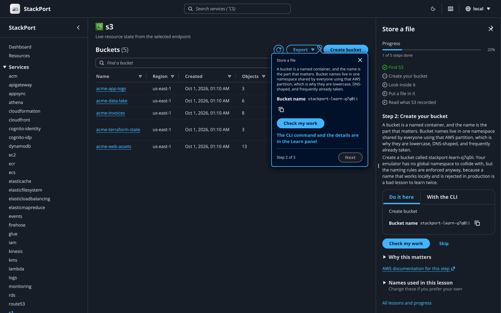
</p>

Open **Learn** in the sidebar (or press `g l`) and start a lesson. Every step gives you two ways through it:

- **Do it here**: the popover points at the control to use, with the exact values to type, copyable.
- **With the CLI**: the command, already filled in with your endpoint and your resource names, plus an explanation of what each flag does.

Either way, verification is the same: StackPort calls the real API and reports what it found. Do the work in a terminal and the step turns green on its own within a few seconds, no clicking required. Nothing is a gate, either: any step can be skipped and re-checked later.

You pick the names. A lesson generates something like `stackport-learn-k3xz` and every command and field on screen uses it, so the commands can be copied and run without editing. Change it under "Names used in this lesson" and everything follows.

Lessons only run against a local emulator, since they create and delete resources. Progress is stored locally in `~/.stackport/learn_progress.json`. Set `STACKPORT_LEARN=false` to remove Learn entirely.

## Tag management

Tags can be read on 24 resource types and edited on 23 of them (CloudFormation stacks are read-only):

S3 buckets, DynamoDB tables, Lambda functions, SQS queues, SNS topics, IAM users/roles/policies, EC2 instances, CloudWatch log groups, Secrets Manager secrets, RDS instances/clusters, KMS keys, ECR repositories, CloudFormation stacks, Step Functions state machines, Kinesis streams, SSM parameters, ELB load balancers, ElastiCache clusters, Cognito user pools, EMR clusters, API Gateway REST APIs

## CLI

```bash
# Start the web UI (same as running `stackport` with no arguments)
stackport serve --port 8080

# Show service availability and resource counts
stackport status
stackport status --output json

# List resources for a service
stackport list s3
stackport list dynamodb --output csv

# Get resource details
stackport describe s3 buckets my-bucket
stackport describe lambda functions my-func --output table

# Export all resources
stackport export lambda --format json
stackport export ec2 --format csv
```

`status`, `list`, `describe`, and `export` accept `--endpoint` (a saved endpoint name or a URL) and `--region REGION`. Without `--endpoint` they use `AWS_ENDPOINT_URL` or the default endpoint saved in Settings. A saved endpoint brings its profile or keys, region and TLS settings (CA bundle, verification off) with it, and `--region` overrides its region. A URL passed directly uses no saved settings.

## Keyboard shortcuts

Press `?` anywhere to see all shortcuts.

| Key | Action |
|-----|--------|
| `?` | Show shortcuts |
| `Alt+S` (`⌥S` on macOS) | Focus service search |
| `b` | Toggle sidebar |
| `t` | Toggle theme |
| `g d` / `g r` / `g l` | Go to Dashboard / Resources / Learn |
| `g s` / `g a` | Go to Settings / About |
| `r` / `v` | Dashboard: refresh / switch grid and list view |
| `j` / `k` | Next / previous row in a resource list |
| `Enter` | Open selected row |
| `Esc` | Close modal |

## Configuration

| Variable | Default | Description |
|---|---|---|
| `AWS_ENDPOINT_URL` | *(unset)* | AWS endpoint. Unset = real AWS via credential chain |
| `AWS_REGION` | `us-east-1` | AWS region |
| `AWS_ACCESS_KEY_ID` | *(unset)* | AWS access key. Unset = use credential chain |
| `AWS_SECRET_ACCESS_KEY` | *(unset)* | AWS secret key. Unset = use credential chain |
| `AWS_PROFILE` | *(unset)* | AWS named profile from `~/.aws/config` |
| `STACKPORT_PORT` | `8080` | StackPort server port |
| `STACKPORT_HOST` | `127.0.0.1` | Interface StackPort listens on (`0.0.0.0` in the Docker image). StackPort has no login, so open it to the network only where that's fine |
| `STACKPORT_ALLOW_WRITES` | `true` | Allow write operations. `false` makes StackPort read-only |
| `STACKPORT_S3_MAX_UPLOAD_MB` | `100` | Max S3 upload size per object (MiB) |
| `STACKPORT_LEARN` | `true` | Guided lessons. `false` removes the Learn routes and UI |
| `STACKPORT_SERVICES` | *(35 services)* | Comma-separated list of services to probe |
| `STACKPORT_PROBE_TIMEOUT` | `5` | Seconds to wait when connecting to a local emulator. Calls to local emulators aren't retried |
| `STACKPORT_CACHE_TTL` | `5` | Seconds to cache service stats |
| `STACKPORT_PROBE_WORKERS` | `10` | Max concurrent workers for service probing |
| `STACKPORT_ENDPOINTS` | *(unset)* | Multiple endpoints: `local=http://localhost:4566,staging=http://...` |
| `STACKPORT_DATA_DIR` | `~/.stackport` | Directory for persistent config (endpoints.json, learn_progress.json) |
| `STACKPORT_ALLOWED_HOSTS` | *(empty)* | Host names browsers may open StackPort through besides `localhost` and IP addresses (comma-separated, `*` for any). Needed behind a reverse proxy, a forwarded port, or a machine name |
| `STACKPORT_CORS_ORIGINS` | *(empty)* | Comma-separated origins allowed to call StackPort's API from another site. Empty means only StackPort's own pages |
| `STACKPORT_AWS_EMULATOR_DIR` | `~/.aws/emulator` | Where to look for the keys and certificate AWS Emulator writes for each port. Empty turns the lookup off |
| `LOG_LEVEL` | `INFO` | Python log level (`DEBUG` shows healthcheck logs) |

## Supported services (35)

ACM, API Gateway, AppSync, Athena, CloudFormation, CloudFront, CloudWatch (metrics and alarms), CloudWatch Logs, Cognito (User Pools + Identity Pools), DynamoDB, EC2, ECR, ECS, EFS, ElastiCache, ELB, EMR, EventBridge, Firehose, Glue, IAM, Kinesis, KMS, Lambda, RDS, Route 53, S3, Secrets Manager, SES, SNS, SQS, SSM, Step Functions, WAFv2

## Development

```bash
git clone https://github.com/DaviReisVieira/stackport.git
cd stackport

# Backend (with test dependencies)
pip install -e ".[dev]"
AWS_ENDPOINT_URL=http://localhost:4566 stackport

# Frontend dev (with hot reload, proxies to :8080)
cd ui && npm install && npm run dev

# Build frontend for production
cd ui && npm run build

# Run tests
python -m pytest -x --tb=short   # backend
cd ui && npx vitest run          # frontend

# Typecheck & lint
cd ui && npx tsc -b
cd ui && npx eslint .
```

See [CONTRIBUTING.md](CONTRIBUTING.md) for full details.

## Architecture

```text
backend/
  main.py           FastAPI app, CORS, read-only middleware, SPA mount
  cli.py            serve, status, list, describe, export
  config.py         All settings from environment variables
  aws_client.py     Cached boto3 client factory
  cache.py          Thread-safe TTL cache
  websocket.py      Live dashboard probes and log tailing
  schemas/          Pydantic request models, one module per service
  learn/            Lesson content (trails/*.json), hotspot ids, verification checks
  routes/
    stats.py        Service registry and concurrent probing
    resources.py    Generic list/detail for all services
    endpoints.py    Endpoint CRUD, health checks, profile listing
    tags.py         Unified tag management
    learn.py        Lessons, progress, verification
    s3.py, dynamodb.py, lambda_svc.py, sqs.py, sns.py, iam.py, ec2.py,
    rds.py, logs.py, monitoring.py, secretsmanager.py, kms.py,
    stepfunctions.py   One module per dedicated view

ui/src/
  pages/            Dashboard, ResourceBrowser, Learn, Settings, About
  components/
    cloudscape/     AppLayout shell, service views, Learn panel (Cloudscape Design System)
  contexts/         Endpoint and Learn state
  hooks/            useFetch, useWebSocket, useKeyboardShortcuts, ...
  lib/              API client, types, service icons, export, utils
```

## Origin

StackPort started as a web UI pull request to [MiniStack](https://github.com/ministackorg/ministack) ([ministack#116](https://github.com/ministackorg/ministack/pull/116)). The MiniStack maintainers suggested it would be more useful as a standalone tool that talks to any emulator over the standard AWS API, and that is what it became. Thanks to [@Nahuel990](https://github.com/Nahuel990) and [@McDoit](https://github.com/McDoit) for pushing it in that direction.

## Contributors

Contributions of every size are welcome. [CONTRIBUTING.md](CONTRIBUTING.md) has the setup and a few good places to start.

<a href="https://github.com/DaviReisVieira/stackport/graphs/contributors">
  
</a>

## Support the project

If StackPort saves you time, a [star on GitHub](https://github.com/DaviReisVieira/stackport/stargazers) helps other people find it.

More guides live at [stackport.cloud](https://stackport.cloud): [introduction](https://stackport.cloud/docs/introduction/), [quick start](https://stackport.cloud/docs/quickstart/), [environment variables](https://stackport.cloud/docs/configuration/environment-variables/), and [CLI commands](https://stackport.cloud/docs/cli/commands/). Questions and bug reports go to [GitHub Issues](https://github.com/DaviReisVieira/stackport/issues).

## License

[MIT](LICENSE)
