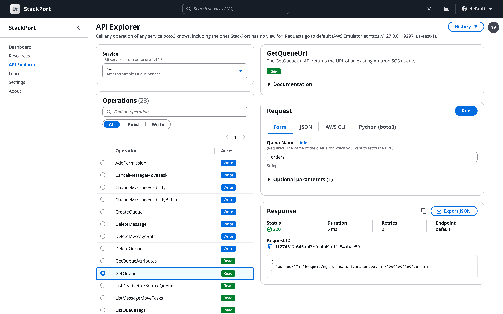

<p align="center">
  
</p>

<h1 align="center">StackPort</h1>
<p align="center"><strong>An open-source web console for local AWS emulators and real AWS.</strong></p>
<p align="center">Browse, inspect, and manage what's running in AWS Emulator, MiniStack, Floci, LocalStack, Moto, or any AWS-compatible endpoint: a live dashboard and resource browser for 51 AWS services, an API Explorer for every operation, and guided lessons that teach AWS hands-on.</p>

<p align="center">
  <a href="https://github.com/DaviReisVieira/stackport/actions/workflows/ci.yml"></a>
  <a href="https://pypi.org/project/stackport/"></a>
  <a href="https://hub.docker.com/r/davireis/stackport"></a>
  <a href="https://hub.docker.com/r/davireis/stackport"></a>
  <a href="https://github.com/DaviReisVieira/stackport/blob/main/LICENSE"></a>
  <a href="https://pypi.org/project/stackport/"></a>
  <a href="https://github.com/DaviReisVieira/stackport/stargazers"></a>
</p>

<p align="center">
  
</p>

## Why StackPort

Local emulators give you AWS on your laptop. StackPort gives you a console to look at it with: a web UI and dashboard that works the same way whichever emulator you run. It's open source, runs locally with one command, and needs no AWS account. It can point at a real AWS account too, with a single setting to make it read-only.

## Works with

| Emulator | Default endpoint | How StackPort connects | Quick start |
|---|---|---|---|
| [AWS Emulator](https://github.com/aws/aws-emulator) | `https://127.0.0.1:9297` | HTTPS. Finds the keys and certificate the emulator writes to `~/.aws/emulator/<port>/` by itself, and the new ones after a restart | [AWS Emulator](#aws-emulator) |
| [MiniStack](https://github.com/ministackorg/ministack) | `http://localhost:4566` | HTTP, any access key (`test`) | [MiniStack](#ministack) |
| [Floci](https://github.com/floci-io/floci) | `http://localhost:4566` | HTTP, any access key (`test`) | [Floci](#floci) |
| [LocalStack](https://github.com/localstack/localstack) | `http://localhost:4566` | HTTP, any access key (`test`) | [LocalStack](#localstack) |
| [Moto](https://github.com/getmoto/moto) | `http://localhost:5000` | HTTP, any access key (`test`) | [Moto](#moto) |
| Any AWS-compatible endpoint, such as MinIO for S3 | Its URL | The keys it accepts | [Other endpoints](#other-endpoints) |
| Real AWS | AWS itself | Your credential chain or a profile (SSO, AssumeRole), optionally read-only | [Real AWS](#with-real-aws) |

[MiniStack](https://github.com/ministackorg/ministack) is StackPort's partner project: StackPort started as a web UI pull request to MiniStack, and the two projects work closely together. Otherwise StackPort is an independent open-source project, not affiliated with or endorsed by AWS or the other emulator projects, and it talks to every emulator the same way, through the standard AWS API.

## Features

- **51 AWS services** discovered and counted on a live dashboard (WebSocket updates, pinned favorites, light and dark themes)
- **13 dedicated service views**: S3, DynamoDB, Lambda, SQS, SNS, IAM, EC2, RDS, CloudWatch Logs, CloudWatch metrics and alarms, Secrets Manager, KMS, and Step Functions. Every other service gets a searchable resource table
- **Write operations** in 9 of those views, from S3 uploads and DynamoDB item edits to SQS messages, Lambda invokes, EC2 start/stop, and Step Functions executions
- **API Explorer** to call any operation of any service boto3 knows, with a form built from the API's own model and the same request ready to copy as an AWS CLI command or boto3 code
- **Activity**: recent API calls from CloudTrail's event history, with who made them, what they touched and how they went
- **Guided lessons** that run inside the console and check your real resource state as you go
- **Real AWS and multiple endpoints**, each with its own auth (default chain, AWS profile with SSO/AssumeRole, or static keys)
- **Read-only mode** with `STACKPORT_ALLOW_WRITES=false`
- **Tags** viewed and edited across 24 resource types
- **Export** resource lists to JSON or CSV, and a **CLI** for `status`, `list`, `describe`, and `export`
- **Keyboard shortcuts** for navigation (press `?` to see them)
- Single Docker image or `pip install`. Works with [AWS Emulator](https://github.com/aws/aws-emulator), [MiniStack](https://github.com/ministackorg/ministack), [Floci](https://github.com/floci-io/floci), [LocalStack](https://github.com/localstack/localstack), [Moto](https://github.com/getmoto/moto), or any AWS-compatible endpoint

## Screenshots

<table>
  <tr>
    <td width="50%"><br/><sub><b>Dashboard</b>: every service with live resource counts</sub></td>
    <td width="50%"><br/><sub><b>Light mode</b>: light, dark, or follow the system</sub></td>
  </tr>
  <tr>
    <td><br/><sub><b>S3</b>: folders, upload, download, bucket settings</sub></td>
    <td><br/><sub><b>Lambda</b>: config, aliases, versions, invoke</sub></td>
  </tr>
  <tr>
    <td><br/><sub><b>DynamoDB</b>: scan, query, and edit items</sub></td>
    <td><br/><sub><b>Step Functions</b>: state machine graph and execution timeline</sub></td>
  </tr>
  <tr>
    <td><br/><sub><b>SQS</b>: send, receive, purge, dead-letter queues</sub></td>
    <td><br/><sub><b>KMS</b>: keys, policies, grants, aliases</sub></td>
  </tr>
  <tr>
    <td><br/><sub><b>API Explorer</b>: any operation boto3 knows, with a form, the response, and the same call as AWS CLI or boto3</sub></td>
    <td><br/><sub><b>Guided lessons</b>: hands-on steps checked against your live resources</sub></td>
  </tr>
</table>

## Quick Start

Install StackPort with `pip install stackport` or use the `davireis/stackport` Docker image, point `AWS_ENDPOINT_URL` at your emulator, and open http://localhost:8080. StackPort signs its requests like any AWS SDK. It finds AWS Emulator's own keys by itself, and MiniStack, Floci, LocalStack and Moto accept any keys, so their commands below pass `test`.

AWS Emulator, MiniStack and Floci also have a Docker Compose example that runs the emulator, StackPort, and a one-shot `seed` container. The seed creates a few resources (S3, SQS, SNS, DynamoDB, Secrets Manager, IAM, Logs, Step Functions) so the dashboard has something to show on first load. For another emulator, replace the emulator service and update `AWS_ENDPOINT_URL`.

### AWS Emulator

[AWS Emulator](https://github.com/aws/aws-emulator) serves HTTPS on `127.0.0.1:9297` and, by default, only accepts requests signed with keys it creates. Its certificate and keys are new on every start, and it writes them to `~/.aws/emulator/<port>/`. StackPort reads them from there, so there are no keys or certificate settings to pass, and it keeps working after the emulator restarts.

Start the emulator as in AWS's guide, [on Linux](https://docs.aws.amazon.com/emulator/latest/userguide/getting-started-linux.html) or [with Docker](https://docs.aws.amazon.com/emulator/latest/userguide/getting-started-docker.html) (which shares `~/.aws/emulator` with your machine), then:

```bash
pip install stackport
AWS_ENDPOINT_URL=https://127.0.0.1:9297 stackport
# Open http://localhost:8080
```

To run both in Docker, use [`examples/docker-compose.aws-emulator.yml`](https://github.com/DaviReisVieira/stackport/blob/main/examples/docker-compose.aws-emulator.yml):

```bash
curl -O https://raw.githubusercontent.com/DaviReisVieira/stackport/main/examples/docker-compose.aws-emulator.yml
docker compose -f docker-compose.aws-emulator.yml up -d
# Open http://localhost:8080
# If the dashboard is empty: docker compose -f docker-compose.aws-emulator.yml logs seed
```

There is no prebuilt emulator image, so the first `up` builds one from the Dockerfile in AWS's guide. StackPort shares the emulator's network, because the certificate only covers `localhost` and loopback addresses, and reads the keys and certificate from a shared volume. The emulator keeps everything in memory, so a restart starts from an empty account. Embedded mode, where the emulator runs inside your tests, has no endpoint for StackPort to connect to.

### MiniStack

[MiniStack](https://github.com/ministackorg/ministack) is StackPort's partner project (see [Origin](#origin)).

```bash
docker run -d -p 4566:4566 ministackorg/ministack   # or: pip install ministack && ministack
pip install stackport
AWS_ENDPOINT_URL=http://localhost:4566 AWS_ACCESS_KEY_ID=test AWS_SECRET_ACCESS_KEY=test stackport
# Open http://localhost:8080
```

With Docker Compose, using [`examples/docker-compose.yml`](https://github.com/DaviReisVieira/stackport/blob/main/examples/docker-compose.yml):

```bash
curl -O https://raw.githubusercontent.com/DaviReisVieira/stackport/main/examples/docker-compose.yml
docker compose up -d
# Open http://localhost:8080
# If the dashboard is empty: docker compose logs seed
```

MiniStack derives the URLs it returns (SQS queue URLs, pre-signed URLs) from the request `Host`, so they resolve from other containers and from the host without extra configuration.

### Floci

```bash
docker run -d -p 4566:4566 floci/floci
pip install stackport
AWS_ENDPOINT_URL=http://localhost:4566 AWS_ACCESS_KEY_ID=test AWS_SECRET_ACCESS_KEY=test stackport
# Open http://localhost:8080
```

With Docker Compose, using [`examples/docker-compose.floci.yml`](https://github.com/DaviReisVieira/stackport/blob/main/examples/docker-compose.floci.yml):

```bash
curl -O https://raw.githubusercontent.com/DaviReisVieira/stackport/main/examples/docker-compose.floci.yml
docker compose -f docker-compose.floci.yml up -d
# Open http://localhost:8080
# If the dashboard is empty: docker compose -f docker-compose.floci.yml logs seed
```

[Floci](https://github.com/floci-io/floci) takes the hostname for the URLs it returns from `FLOCI_HOSTNAME`, which the example sets to `floci` so they resolve from other containers. From the host, reach the same resources through `http://localhost:4566`.

Floci can also start StackPort for you as its web console, at `http://localhost:4566/_floci/ui`: see [Running a different console](https://github.com/floci-io/floci#running-a-different-console) in Floci's README.

### LocalStack

```bash
docker run -d -p 4566:4566 -e LOCALSTACK_AUTH_TOKEN=<your-token> localstack/localstack
pip install stackport
AWS_ENDPOINT_URL=http://localhost:4566 AWS_ACCESS_KEY_ID=test AWS_SECRET_ACCESS_KEY=test stackport
# Open http://localhost:8080
```

Recent [LocalStack](https://github.com/localstack/localstack) images ask for an auth token from your LocalStack account. If you start LocalStack with `localstack start` instead, the StackPort command is the same.

### Moto

```bash
docker run -d -p 5000:5000 motoserver/moto   # or: pip install "moto[server]" && moto_server
pip install stackport
AWS_ENDPOINT_URL=http://localhost:5000 AWS_ACCESS_KEY_ID=test AWS_SECRET_ACCESS_KEY=test stackport
# Open http://localhost:8080
```

[Moto](https://github.com/getmoto/moto) listens on port 5000. On macOS, AirPlay Receiver can hold that port: publish Moto on another one (`-p 5001:5000`) and use it in `AWS_ENDPOINT_URL`.

### Other endpoints

StackPort works with any endpoint that speaks the AWS API. Set `AWS_ENDPOINT_URL` and keys the endpoint accepts:

```bash
# MinIO (S3 only), with a MinIO access key
AWS_ENDPOINT_URL=http://localhost:9000 AWS_ACCESS_KEY_ID=<access-key> AWS_SECRET_ACCESS_KEY=<secret-key> stackport

# Any custom endpoint
AWS_ENDPOINT_URL=http://my-emulator:4566 AWS_ACCESS_KEY_ID=test AWS_SECRET_ACCESS_KEY=test stackport
```

### Docker (standalone)

```bash
docker run -p 127.0.0.1:8080:8080 \
  -e AWS_ENDPOINT_URL=http://host.docker.internal:4566 \
  -e AWS_ACCESS_KEY_ID=test -e AWS_SECRET_ACCESS_KEY=test \
  davireis/stackport
```

`host.docker.internal` is how a container reaches an emulator published on your machine under Docker Desktop. For AWS Emulator, use its Compose example instead: StackPort has to share the emulator's network and see its keys and certificate.

## Real AWS and multiple endpoints

### With real AWS

Leave `AWS_ENDPOINT_URL` unset and StackPort uses the standard AWS credential chain:

```bash
# Using an AWS profile
AWS_PROFILE=my-profile stackport

# Using explicit credentials
AWS_ACCESS_KEY_ID=AKIA... AWS_SECRET_ACCESS_KEY=... AWS_REGION=us-west-2 stackport

# Read-only: block every write from the UI and API
STACKPORT_ALLOW_WRITES=false AWS_PROFILE=my-profile stackport
```

An endpoint without a URL sends every request to AWS itself. Endpoint URLs set up for other AWS tools, in `AWS_ENDPOINT_URL_<SERVICE>` variables (like `AWS_ENDPOINT_URL_S3`) or in a profile's `endpoint_url` and `services` settings in `~/.aws/config`, don't apply to StackPort. A profile still provides the credentials.

When connected to real AWS, StackPort shows a warning banner on every page. Writes stay enabled unless you set `STACKPORT_ALLOW_WRITES=false`, so use that whenever you only want to look. In read-only mode a lock appears in the top bar, and the only POST calls still allowed are the ones that read: DynamoDB queries, CloudWatch metric queries, Lambda invokes (which run your function, so keep that in mind on a live account), and API Explorer operations that read.

### Multiple endpoints

Switch between endpoints from the UI. Configure named endpoints with `STACKPORT_ENDPOINTS`, or add them later from Settings:

```bash
# A local emulator and a real AWS account (empty URL = real AWS)
STACKPORT_ENDPOINTS="local=http://localhost:4566,nprod=" \
  AWS_PROFILE=nprod AWS_REGION=us-west-1 stackport
```

**Docker Compose (local + real AWS):**

```bash
curl -O https://raw.githubusercontent.com/DaviReisVieira/stackport/main/examples/docker-compose.multi-endpoint.yml
docker compose -f docker-compose.multi-endpoint.yml up -d
# Open http://localhost:8080
```

See [`examples/docker-compose.multi-endpoint.yml`](https://github.com/DaviReisVieira/stackport/blob/main/examples/docker-compose.multi-endpoint.yml) for a full example with MiniStack + real AWS via profile.

The endpoint menu sits in the top navigation bar. Each endpoint is health-checked independently, and all API requests, caches, and WebSocket subscriptions are scoped to the active endpoint.

### Per-endpoint authentication

Each endpoint can use its own AWS authentication method, configured from the Settings page:

| Auth Type | Description | Use Case |
|-----------|-------------|----------|
| **Default** | Uses AWS Emulator's own keys for an AWS Emulator endpoint, otherwise `AWS_ACCESS_KEY_ID`/`AWS_SECRET_ACCESS_KEY` env vars or instance role | Local emulators, EC2/ECS deployments |
| **AWS Profile** | Uses a named profile from `~/.aws/config` | SSO, AssumeRole, multiple accounts |
| **Static Credentials** | Per-endpoint access key and secret | Service accounts, cross-account access |

**Profile auth** supports SSO, AssumeRole, and credential_process (anything `boto3.Session(profile_name=...)` handles). If your SSO token expires, StackPort returns a 401 with instructions to run `aws sso login --profile <name>`.

**Docker users:** mount your AWS config to use profiles inside the container:

```yaml
services:
  stackport:
    image: davireis/stackport
    volumes:
      - ~/.aws:/root/.aws
```

**HTTPS endpoints** can also have their own certificate settings: a CA bundle to trust (a PEM file on the machine that runs StackPort), or certificate checks turned off. They are set per endpoint because `AWS_CA_BUNDLE` replaces the system certificates, so setting it for the whole process would break a real AWS endpoint configured next to an emulator. AWS Emulator needs neither when StackPort reaches it on 127.0.0.1 (on the same machine, or sharing its network as in the Compose example): StackPort trusts the certificate the emulator wrote to `~/.aws/emulator/<port>/` and, with the Default auth type, signs with the keys it wrote there.

You can test a connection before saving it with the "Test Connection" button in the add/edit endpoint dialog.

## Service views

### Dedicated views (13 services)

| Service | Browse | Write operations |
|---------|--------|------------------|
| **S3** | Buckets, objects, folder navigation, search | Create buckets and folders, upload, download, delete, batch delete; edit versioning, lifecycle, notifications, CORS, tags |
| **DynamoDB** | Tables, schema, items, scan and query, live item count | Create tables, add, edit and delete items, batch write |
| **Lambda** | Functions, config, aliases, versions, event sources | Invoke with a JSON payload, edit configuration, download code |
| **SQS** | Queues, messages, attributes | Create and delete queues, send (single or batch), receive, delete messages, purge, edit attributes and redrive policy |
| **SNS** | Topics, subscriptions | Create and delete topics, subscribe, unsubscribe, publish |
| **EC2** | Instances, Auto Scaling groups, VPCs and subnets, security group rules, key pairs | Start, stop, reboot, terminate instances |
| **CloudWatch Logs** | Log groups, streams, events with time and pattern filters, live tail | Create and delete log groups, delete streams, set retention |
| **Secrets Manager** | Secrets with value reveal, rotation status | Create, update value and metadata, delete, restore |
| **Step Functions** | State machines with an ASL graph, executions, execution timeline | Start and stop executions |
| **IAM** | Users, roles, groups, policies, trust policies | Read-only |
| **RDS** | Instances, clusters, snapshots, parameter groups | Read-only |
| **CloudWatch** | Dashboards, alarms, metric charts | Read-only |
| **KMS** | Keys, key policies, grants, aliases | Read-only |

### Generic resource browser (38 services)

Every other service uses a searchable resource table with a JSON detail view, tag editing where supported, pagination, and export to JSON or CSV.

## API Explorer

The service views cover what StackPort knows about, and emulators implement much more. Open **API Explorer** in the sidebar (or press `g e`) to call any operation of any service boto3 knows against the selected endpoint, including services StackPort has no view for.

- Pick a service and an operation. The list comes from botocore's own models, with each operation's documentation and whether it reads or writes.
- Fill in a form built from the operation's input: required fields first, dropdowns for enums, a key and value editor for maps, and JSON for nested structures. The JSON tab holds the whole request, and edits in either place show up in the other.
- Run it and get the response as JSON with its HTTP status, request ID and duration. Errors come back with the endpoint's own status and message.
- Paginated operations can follow up to 50 pages in one run, and "Fetch next page" continues where a run stopped.
- The AWS CLI and Python (boto3) tabs show the same request as a command or code to copy. When the endpoint's emulator needs more than `--endpoint-url` (AWS Emulator's keys and certificate), the tabs show the shell setup to run first, the same as Learn does.
- Links like `/explorer?service=sqs&operation=ListQueues` open an operation directly, and the History menu keeps your last requests in this browser (values the API marks as sensitive, such as secret strings, are left out).

Bytes that aren't text travel as `{"$base64": "..."}`, both in responses and in the parameters you send. Streamed responses (an S3 object, a Lambda invoke) show their first 1 MB, responses over 5 MB of JSON aren't shown, and operations that stream events can only be copied, not run.

In read-only mode the explorer only runs operations that read (Describe, Get, List and similar). Operations named like reads that create something or hand out credentials, tokens or passwords (`sts GetSessionToken`, `ecr GetAuthorizationToken`) count as writes; reading a stored value, such as a secret's value, stays a read, as it is in the console's views. The others stay visible so you can still build the request and copy it. On real AWS, and while StackPort can't yet tell whether the endpoint is AWS, operations that write ask for confirmation before they run.

## Activity

Open **Activity** in the sidebar to see the API calls CloudTrail recorded (`LookupEvents`), newest first: the event name and source, who made the call, the resources it named, whether it only read, and the error code when it failed. Click an event to see its whole CloudTrail record, copy it or export it.

- Choose a time range (the last hour to start with) and a lookup attribute: event name, event source, user name, resource name or type, access key, event ID, or read-only. CloudTrail looks up one attribute per call, so it's one choice rather than a set of filters. The text box then searches the events already loaded, records included.
- The page starts with calls that change something (read-only is false). Choose **All events** to see reads too, StackPort's own among them.
- Links keep the filters, for example `/activity?attribute=EventSource&value=sqs.amazonaws.com&range=3h`.
- **Load older events** asks for the next page, and auto-refresh looks again every 10 seconds while the tab is visible. Each is a single `LookupEvents` call: AWS allows two a second per account and Region.

What shows up depends on the endpoint. As checked with each emulator:

| Emulator | Activity |
|---|---|
| AWS Emulator (1.0.367) | Records calls to about a dozen services (CloudFormation, CloudFront, CloudTrail, CodePipeline, Cognito Identity, EC2, Elastic Load Balancing, IAM, RDS, SQS, Step Functions, STS), failed calls and reads included. S3 and DynamoDB calls don't show up |
| MiniStack (1.5.19) | Records every call when started with `CLOUDTRAIL_RECORDING=1` (off by default), up to 50 events per lookup. Calls to Query APIs such as IAM and STS are named `POST.iam`, `POST.sts` |
| Floci (2.4.0) | Answers with no events |
| LocalStack (4.14, no auth token) | Answers that CloudTrail isn't in the current license plan, so the page says the endpoint doesn't support it |
| Moto (5.2) | `LookupEvents` isn't implemented; Moto answers with an internal error, which the page shows |

## Guided lessons

Learn AWS hands-on without an AWS account or a bill. Lessons run inside StackPort against your own emulator: a panel walks you through each step while hotspots point at the actual controls, and StackPort checks the live resource state, so a step only turns green when the thing really exists.

<p align="center">
  
</p>

Open **Learn** in the sidebar (or press `g l`) and start a lesson. Every step gives you two ways through it:

- **Do it here**: the popover points at the control to use, with the exact values to type, copyable.
- **With the CLI**: the command, already filled in with your endpoint and your resource names, plus an explanation of what each flag does.

Either way, verification is the same: StackPort calls the real API and reports what it found. Do the work in a terminal and the step turns green on its own within a few seconds, no clicking required. Nothing is a gate, either: any step can be skipped and re-checked later.

You pick the names. A lesson generates something like `stackport-learn-k3xz` and every command and field on screen uses it, so the commands can be copied and run without editing. Change it under "Names used in this lesson" and everything follows.

Lessons only run against a local emulator, since they create and delete resources. Progress is stored locally in `~/.stackport/learn_progress.json`. Set `STACKPORT_LEARN=false` to remove Learn entirely.

## Tag management

Tags can be read on 24 resource types and edited on 23 of them (CloudFormation stacks are read-only):

S3 buckets, DynamoDB tables, Lambda functions, SQS queues, SNS topics, IAM users/roles/policies, EC2 instances, CloudWatch log groups, Secrets Manager secrets, RDS instances/clusters, KMS keys, ECR repositories, CloudFormation stacks, Step Functions state machines, Kinesis streams, SSM parameters, ELB load balancers, ElastiCache clusters, Cognito user pools, EMR clusters, API Gateway REST APIs

## CLI

```bash
# Start the web UI (same as running `stackport` with no arguments)
stackport serve --port 8080

# Show service availability and resource counts
stackport status
stackport status --output json

# List resources for a service
stackport list s3
stackport list dynamodb --output csv

# Get resource details
stackport describe s3 buckets my-bucket
stackport describe lambda functions my-func --output table

# Export all resources
stackport export lambda --format json
stackport export ec2 --format csv
```

`status`, `list`, `describe`, and `export` accept `--endpoint` (a saved endpoint name or a URL) and `--region REGION`. Without `--endpoint` they use `AWS_ENDPOINT_URL` or the default endpoint saved in Settings. A saved endpoint brings its profile or keys, region and TLS settings (CA bundle, verification off) with it, and `--region` overrides its region. A URL passed directly uses no saved settings.

## Keyboard shortcuts

Press `?` anywhere to see all shortcuts.

| Key | Action |
|-----|--------|
| `?` | Show shortcuts |
| `Alt+S` (`⌥S` on macOS) | Focus service search |
| `b` | Toggle sidebar |
| `t` | Toggle theme |
| `g d` / `g r` / `g e` / `g l` | Go to Dashboard / Resources / API Explorer / Learn |
| `g s` / `g a` | Go to Settings / About |
| `r` / `v` | Dashboard: refresh / switch grid and list view |
| `j` / `k` | Next / previous row in a resource list |
| `Enter` | Open selected row |
| `Esc` | Close modal |

## Configuration

| Variable | Default | Description |
|---|---|---|
| `AWS_ENDPOINT_URL` | *(unset)* | AWS endpoint. Unset = real AWS via credential chain |
| `AWS_REGION` | `us-east-1` | AWS region |
| `AWS_ACCESS_KEY_ID` | *(unset)* | AWS access key. Unset = use credential chain |
| `AWS_SECRET_ACCESS_KEY` | *(unset)* | AWS secret key. Unset = use credential chain |
| `AWS_SESSION_TOKEN` | *(unset)* | Session token for temporary credentials (SSO exports, assumed roles). Sent only with the two keys above. Read at start-up, so a new token needs a restart |
| `AWS_PROFILE` | *(unset)* | AWS named profile from `~/.aws/config` |
| `STACKPORT_PORT` | `8080` | StackPort server port |
| `STACKPORT_HOST` | `127.0.0.1` | Interface StackPort listens on (`0.0.0.0` in the Docker image). StackPort has no login, so open it to the network only where that's fine |
| `STACKPORT_ALLOW_WRITES` | `true` | Allow write operations. `false` makes StackPort read-only |
| `STACKPORT_S3_MAX_UPLOAD_MB` | `100` | Max S3 upload size per object (MiB) |
| `STACKPORT_LEARN` | `true` | Guided lessons. `false` removes the Learn routes and UI |
| `STACKPORT_SERVICES` | *(51 services)* | Comma-separated list of services to probe |
| `STACKPORT_PROBE_TIMEOUT` | `5` | Seconds to wait when connecting to a local emulator. Calls to local emulators aren't retried |
| `STACKPORT_CACHE_TTL` | `5` | Seconds to cache service stats |
| `STACKPORT_PROBE_WORKERS` | `10` | Max concurrent workers for service probing |
| `STACKPORT_ENDPOINTS` | *(unset)* | Multiple endpoints: `local=http://localhost:4566,staging=http://...` |
| `STACKPORT_DATA_DIR` | `~/.stackport` | Directory for persistent config (endpoints.json, learn_progress.json) |
| `STACKPORT_ALLOWED_HOSTS` | *(empty)* | Host names browsers may open StackPort through besides `localhost` and IP addresses (comma-separated, `*` for any). Needed behind a reverse proxy, a forwarded port, or a machine name |
| `STACKPORT_CORS_ORIGINS` | *(empty)* | Comma-separated origins allowed to call StackPort's API from another site. Empty means only StackPort's own pages |
| `STACKPORT_AWS_EMULATOR_DIR` | `~/.aws/emulator` | Where to look for the keys and certificate AWS Emulator writes for each port. Empty turns the lookup off |
| `LOG_LEVEL` | `INFO` | Python log level (`DEBUG` shows healthcheck logs) |
| `STACKPORT_LOG_AWS_WIRE` | `false` | Also log botocore's requests and responses at `DEBUG`. They include parameter values, secrets and session tokens, so turn it on only to debug a connection |

## Supported services (51)

ACM, API Gateway, AppConfig, AppSync, Athena, Batch, Bedrock, Cloud Map, CloudFormation, CloudFront, CloudTrail, CloudWatch (metrics and alarms), CloudWatch Logs, CodeBuild, CodeCommit, CodeDeploy, CodePipeline, Cognito (User Pools + Identity Pools), DynamoDB, EC2, ECR, ECS, EFS, EKS, ElastiCache, ELB, EMR, EventBridge, EventBridge Pipes, EventBridge Scheduler, Firehose, Glue, IAM, Kinesis, KMS, Lambda, MSK, OpenSearch, RDS, Route 53, S3, Secrets Manager, SES, SNS, SQS, SSM, Step Functions, Verified Permissions, WAFv2, X-Ray

## FAQ

**Is there a web UI for AWS Emulator?**
StackPort works as one. Start the emulator as in AWS's guide and run `AWS_ENDPOINT_URL=https://127.0.0.1:9297 stackport`: it finds the emulator's keys and certificate by itself. [AWS Emulator](#aws-emulator) has the details and a Docker Compose example.

**Does it work with MiniStack, Floci, LocalStack and Moto?**
Yes, and with any other endpoint that speaks the AWS API, since StackPort only makes standard AWS calls. How much of the dashboard fills in depends on the services each emulator implements: the ones it doesn't are shown as not supported rather than failing. MiniStack is StackPort's partner project, and Floci can start StackPort as its web console.

**Do I need an AWS account?**
No. Against a local emulator, StackPort's requests only go to the emulator, and no AWS account is involved.

**Can I use it with real AWS safely?**
Yes, with some care. Leave `AWS_ENDPOINT_URL` unset and StackPort uses your usual credentials or a profile, with a warning banner on every page. Set `STACKPORT_ALLOW_WRITES=false` to block writes from the UI and API; a few calls that only read stay allowed, including Lambda invokes, which run your function. For a guarantee from AWS itself, use a profile whose IAM permissions are read-only. StackPort has no login, so keep it on `127.0.0.1`, the default.

**Does StackPort send data anywhere?**
No. It has no telemetry, analytics or update checks. The server only talks to the endpoints you configure (on real AWS, that includes the STS or SSO calls your credentials need), and the UI loads everything from StackPort itself. Endpoints and lesson progress are saved in `~/.stackport`, and API Explorer history in your browser. The emulator you run may collect telemetry of its own, so check its documentation.

## Development

```bash
git clone https://github.com/DaviReisVieira/stackport.git
cd stackport

# Backend (with test dependencies)
pip install -e ".[dev]"
AWS_ENDPOINT_URL=http://localhost:4566 AWS_ACCESS_KEY_ID=test AWS_SECRET_ACCESS_KEY=test stackport

# Frontend dev (with hot reload, proxies to :8080)
cd ui && npm install && npm run dev

# Build frontend for production
cd ui && npm run build

# Run tests
python -m pytest -x --tb=short   # backend
cd ui && npx vitest run          # frontend

# Typecheck & lint
cd ui && npx tsc -b
cd ui && npx eslint .
```

See [CONTRIBUTING.md](https://github.com/DaviReisVieira/stackport/blob/main/CONTRIBUTING.md) for full details.

## Architecture

```text
backend/
  main.py           FastAPI app, CORS, read-only middleware, SPA mount
  cli.py            serve, status, list, describe, export
  config.py         All settings from environment variables
  aws_client.py     Cached boto3 client factory
  cache.py          Thread-safe TTL cache
  websocket.py      Live dashboard probes and log tailing
  schemas/          Pydantic request models, one module per service
  learn/            Lesson content (trails/*.json), hotspot ids, verification checks
  routes/
    stats.py        Service registry and concurrent probing
    resources.py    Generic list/detail for all services
    endpoints.py    Endpoint CRUD, health checks, profile listing
    tags.py         Unified tag management
    learn.py        Lessons, progress, verification
    activity.py     CloudTrail event history for the Activity page
    explorer.py     API Explorer: any operation botocore knows
    s3.py, dynamodb.py, lambda_svc.py, sqs.py, sns.py, iam.py, ec2.py,
    rds.py, logs.py, monitoring.py, secretsmanager.py, kms.py,
    stepfunctions.py   One module per dedicated view

ui/src/
  pages/            Dashboard, ResourceBrowser, Activity, ApiExplorer, Learn, Settings, About
  components/
    cloudscape/     AppLayout shell, service views, Learn panel (Cloudscape Design System)
  contexts/         Endpoint and Learn state
  hooks/            useFetch, useWebSocket, useKeyboardShortcuts, ...
  lib/              API client, types, service icons, export, utils
```

## Origin

StackPort started as a web UI pull request to [MiniStack](https://github.com/ministackorg/ministack) ([ministack#116](https://github.com/ministackorg/ministack/pull/116)). The MiniStack maintainers suggested it would be more useful as a standalone tool that talks to any emulator over the standard AWS API, and that is what it became. MiniStack is StackPort's partner project today, and the two projects work closely together. Thanks to [@Nahuel990](https://github.com/Nahuel990) and [@McDoit](https://github.com/McDoit) for pushing it in that direction.

## Contributors

Contributions of every size are welcome. [CONTRIBUTING.md](https://github.com/DaviReisVieira/stackport/blob/main/CONTRIBUTING.md) has the setup and a few good places to start.

<a href="https://github.com/DaviReisVieira/stackport/graphs/contributors">
  
</a>

## Support the project

If StackPort saves you time, a [star on GitHub](https://github.com/DaviReisVieira/stackport/stargazers) helps other people find it.

More guides live at [stackport.cloud](https://stackport.cloud): [introduction](https://stackport.cloud/docs/introduction/), [quick start](https://stackport.cloud/docs/quickstart/), [environment variables](https://stackport.cloud/docs/configuration/environment-variables/), and [CLI commands](https://stackport.cloud/docs/cli/commands/). Questions and bug reports go to [GitHub Issues](https://github.com/DaviReisVieira/stackport/issues).

## License

[MIT](https://github.com/DaviReisVieira/stackport/blob/main/LICENSE)
